# Отчёт · Практика 1. BIOS/UEFI

**Студент:** Товстенко Оскар, группа 9/2-РПО-25/1
**Дата:** 12.11.2026

## 1. Разделы меню

В Setup шесть пунктов: Main, Config, Date/Time, Security, Startup, Restart.

Где лежат настройки из задач 2–5:

| Задача | Путь |
|---|---|
| Порядок загрузки | Startup → Boot → Boot Priority Order |
| Secure Boot | Security → Secure Boot → Secure Boot |
| Пароль супервизора | Security → Password → Supervisor Password |
| Сброс | Restart → Load Factory Defaults (внизу экрана та же роль у F9 Setup Defaults) |

Сохранение — F10 Save and Exit.

## 2. Порядок загрузки

Исходный порядок: Windows Boot Manager, USB CD, USB FDD, NVMe0 SKHynix_HFS256GD9TNG-L5B0B, USB HDD, далее PXE BOOT, LENOVO CLOUD, ON-PREMISE. Ниже черты Excluded from Boot Priority Order лежат Other CD и Other HDD.

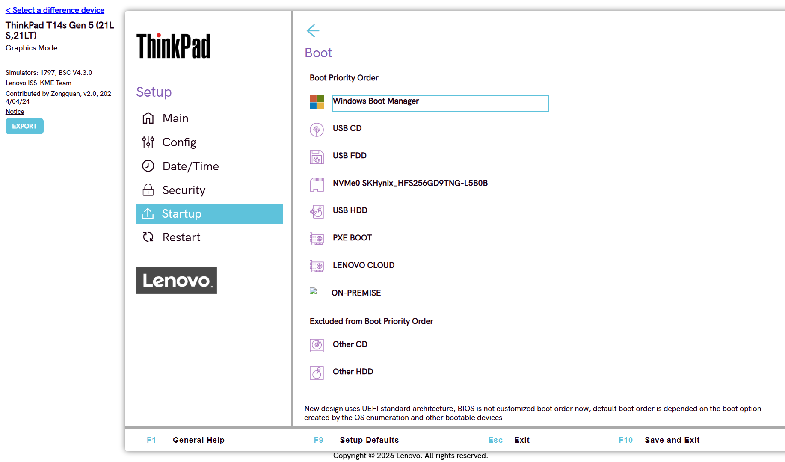

USB HDD поставлен первым, NVMe0 — вторым. Windows Boot Manager сдвинулся на третье место. Этот порядок снова виден после входа в Startup → Boot.

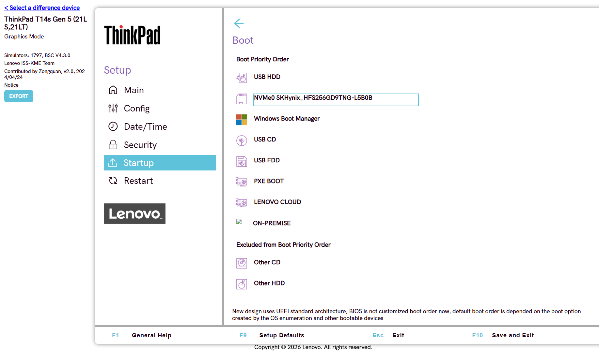

Клавиша сохранения — F10, пункт внизу экрана называется Save and Exit.

## 3. Secure Boot

Путь: Security → Secure Boot → Secure Boot. Рядом стоят Secure Boot Mode (User Mode) и Secure Boot Key State (Standard Mode).

Secure Boot проверяет подпись загрузчика. Неподписанный или изменённый загрузчик система не запускает. Включается и выключается в Security → Secure Boot.

Статус был On. Его переключил на Off и вернул обратно на On. Отдельного окна «нужна перезагрузка» симулятор не показал: статус в меню меняется сразу. На реальном ThinkPad эта смена записывается через F10 и начинает действовать после перезагрузки.

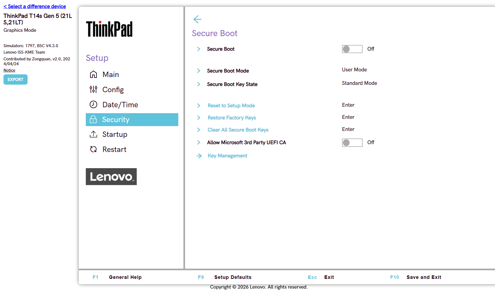

## 4. Пароль супервизора

Путь: Security → Password → Supervisor Password. До установки статус был Disabled.

В окне два поля: Enter New Password и Confirm New Password. В оба вписан `Test1234`, затем Save. Статус стал Enabled.

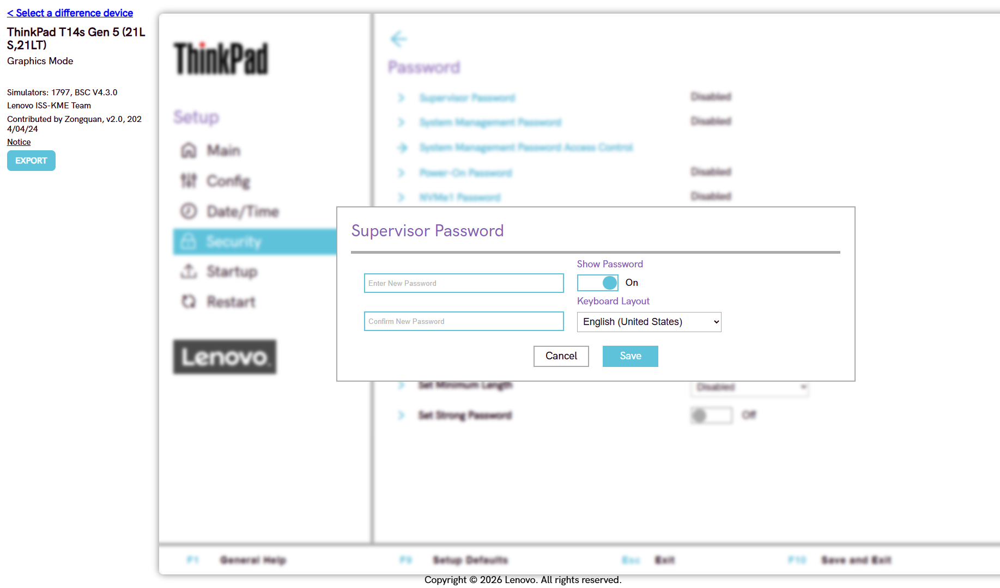

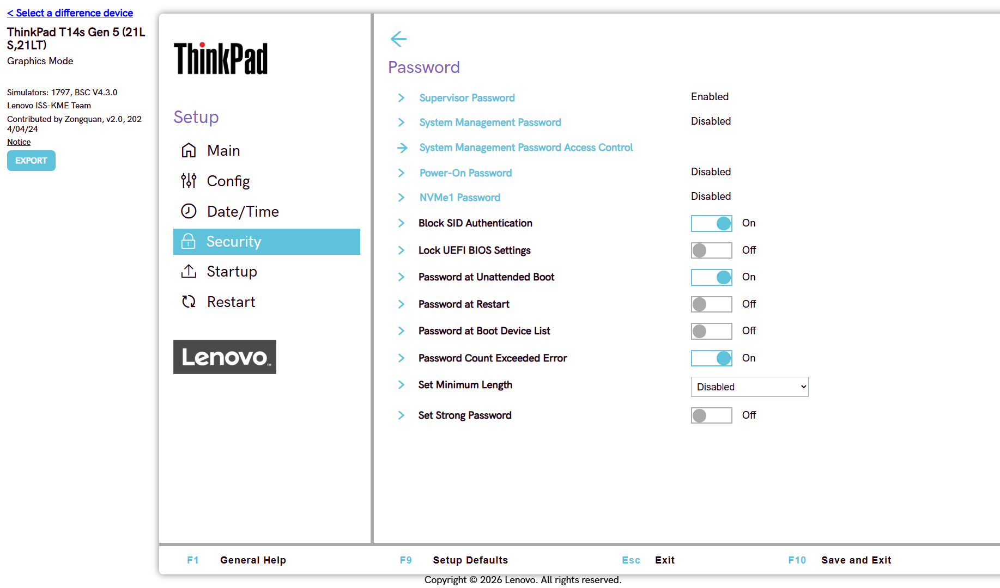

После этого менялся порядок загрузки. Отдельного запроса пароля симулятор не вывел, статус при этом остался Enabled. Пустым полем пароль не снимается: окно пишет «Password must has at least 1 character». Снят он вместе с заводским сбросом в задаче 5: после Load Factory Defaults статус снова Disabled.

## 5. Заводские настройки

Путь: Restart → Load Factory Defaults. Внизу экрана то же действие вызывается клавишей F9 (Setup Defaults).

Подсказка пункта говорит, что в заводские значения вернутся все пункты Setup, а Security и Date & Time этим пунктом не сбрасываются и их надо менять отдельно.

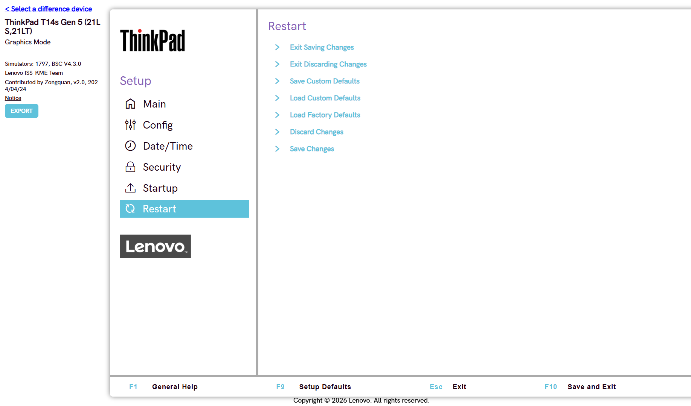

Подтверждение: «Load the BIOS factory default configuration now?» Ответ Yes.

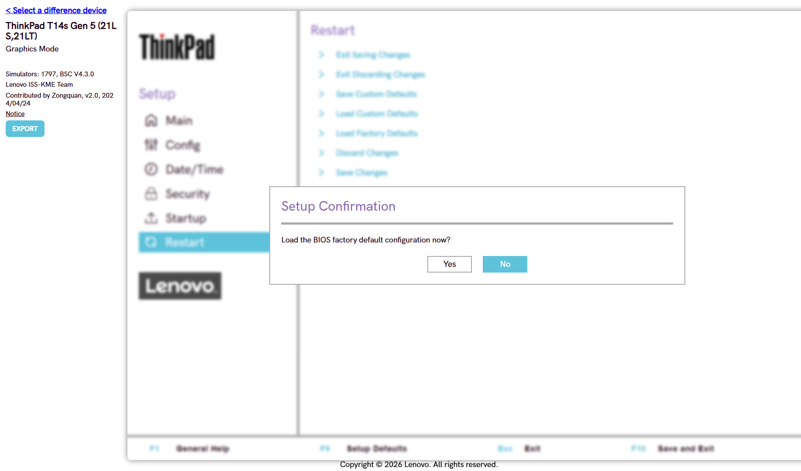

После сброса проверены задачи 2–4. Порядок загрузки снова начинается с Windows Boot Manager. Supervisor Password — Disabled. Secure Boot — On. Always On USB — On.

## 6. Встроенный USB

Пункта USB BIOS Support в этом меню нет. Нужная настройка называется Always On USB.

Путь: Config → USB → Always On USB.

Она была On. Выключил: стало Off, и строка Charge in Battery Mode при этом скрылась. Затем включил обратно, Charge in Battery Mode снова видна и стоит Off.

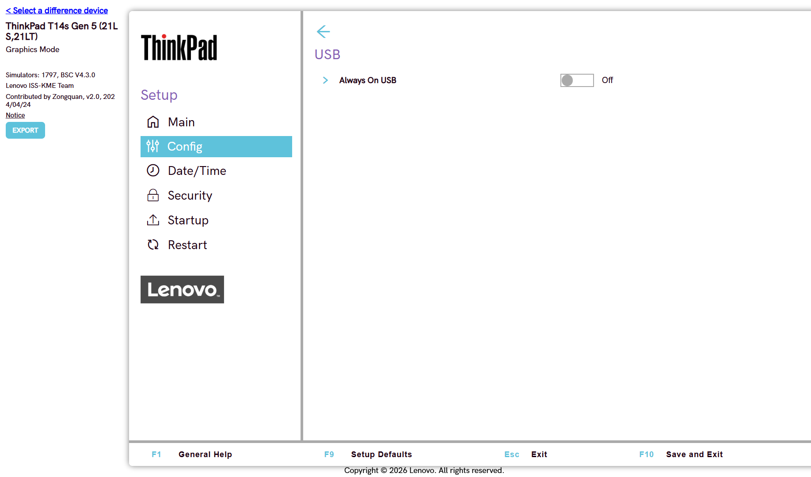

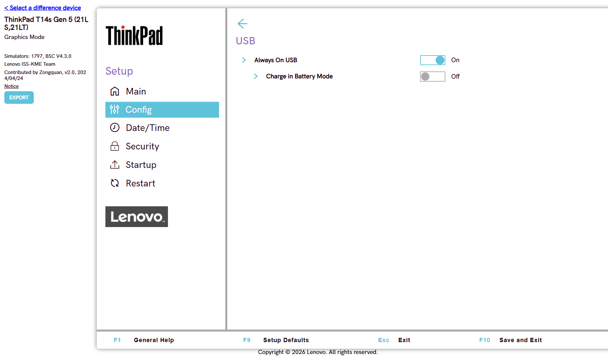

## 7. Режим диска

В Config этой модели нет пунктов Storage, SATA Controller Mode и NVMe Mode. Список Config такой: Network, USB, Keyboard/Mouse, Display, Power, Beep and Alarm, CPU, Thunderbolt(TM) 4, Intel(R) AMT, Intel(R) Standard Manageability. Диск в порядке загрузки один: NVMe0 SKHynix_HFS256GD9TNG-L5B0B.

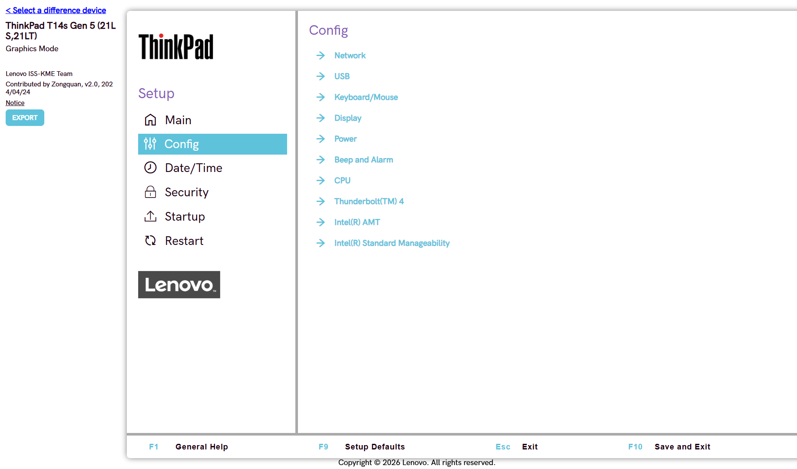

На машинах, где контроллер SATA ещё есть, режимы такие: AHCI, RAID и Intel RST. Смена режима меняет то, как система видит диск. Если у установленной Windows нет драйвера под новый режим, она не загрузится, пока режим не вернут или драйвер не поставят.

## 8. Временное меню загрузки

Постоянный порядок лежит в Startup → Boot и сохраняется через F10. Разовый выбор устройства его не переписывает: это Startup → Boot device List F12 Option. На этом экране пункт уже On.

Рядом Boot Mode: Quick или Diagnostics. Quick не показывает диагностическую заставку, если при старте не нажать Esc. Diagnostics показывает её при каждой загрузке. Режим переключён на Diagnostics и возвращён на Quick.

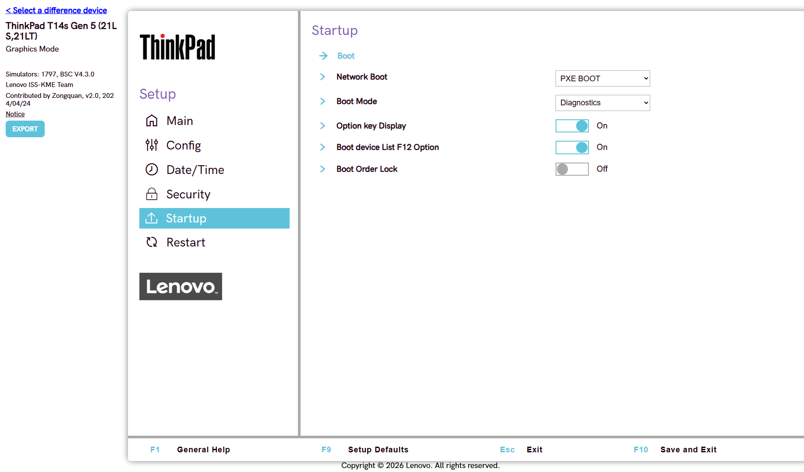

## 9. Раздел логов

Раздел есть. Он называется BIOS Event log и находится в Main. Отдельного пункта System Summary на этом ThinkPad нет: сводка системы — это сам экран Main, а строка лога стоит внизу этого списка.

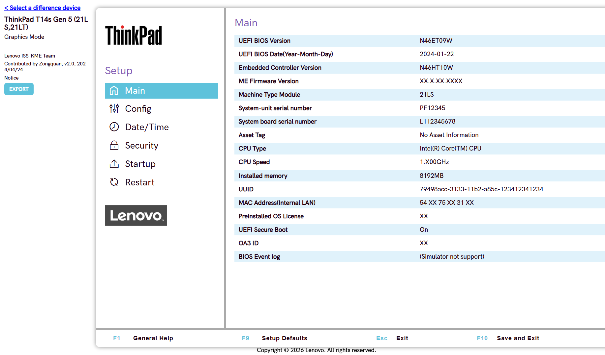

## 10. Подготовка к переустановке

После заводского сброса шаги такие.

1. Load Factory Defaults уже выполнен в задаче 5.
2. Secure Boot проверен: статус On.

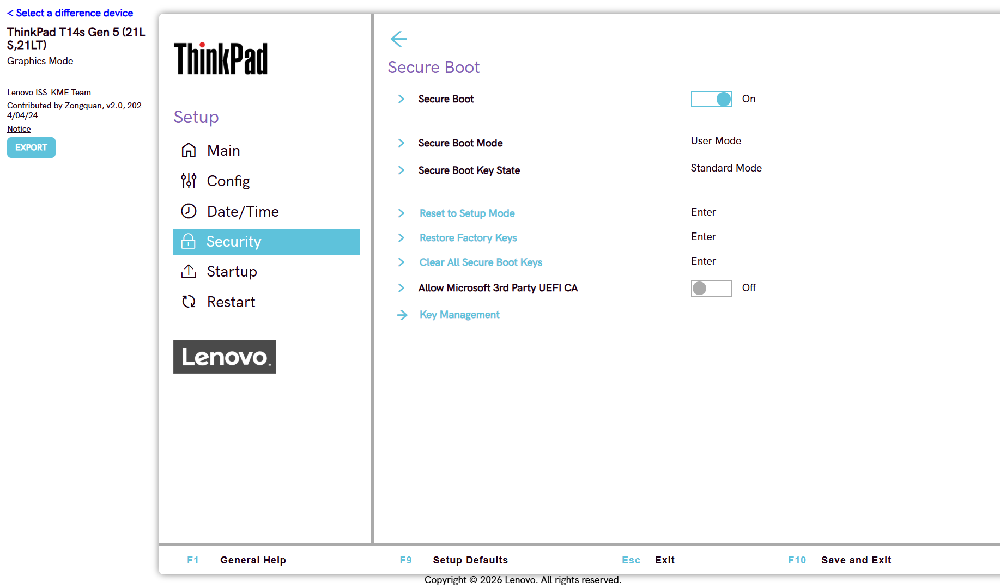

3. Supervisor Password снова установлен, `Test1234`, статус Enabled. Скриншот того же окна — в задаче 4.
4. В Startup → Boot первым стоит USB HDD, вторым NVMe0.

5. F10 открывает окно «Save configuration changes and exit now?». Нажато Yes.

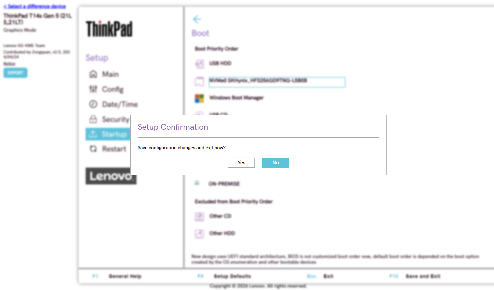

6. Повторный вход в Startup → Boot показывает тот же порядок: USB HDD, затем NVMe0. Пароль супервизора остаётся Enabled, Secure Boot остаётся On. Пустым полем пароль не снимается. Повторный Load Factory Defaults снял пароль (статус Disabled) и вернул порядок загрузки: первым снова Windows Boot Manager, NVMe0 на четвёртом месте, USB HDD на пятом.
